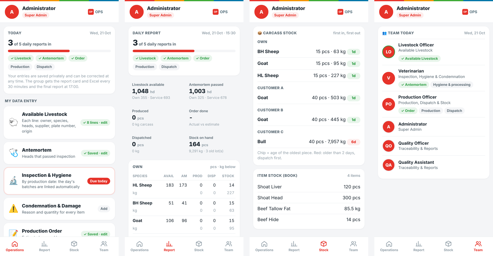
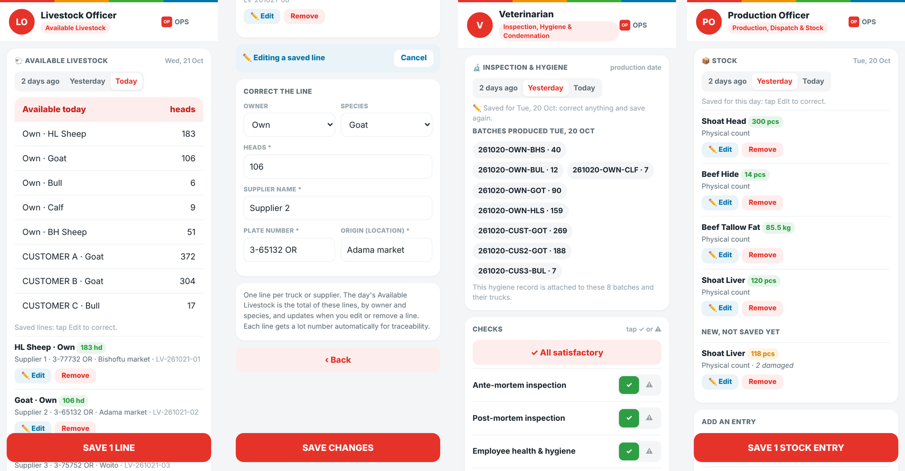
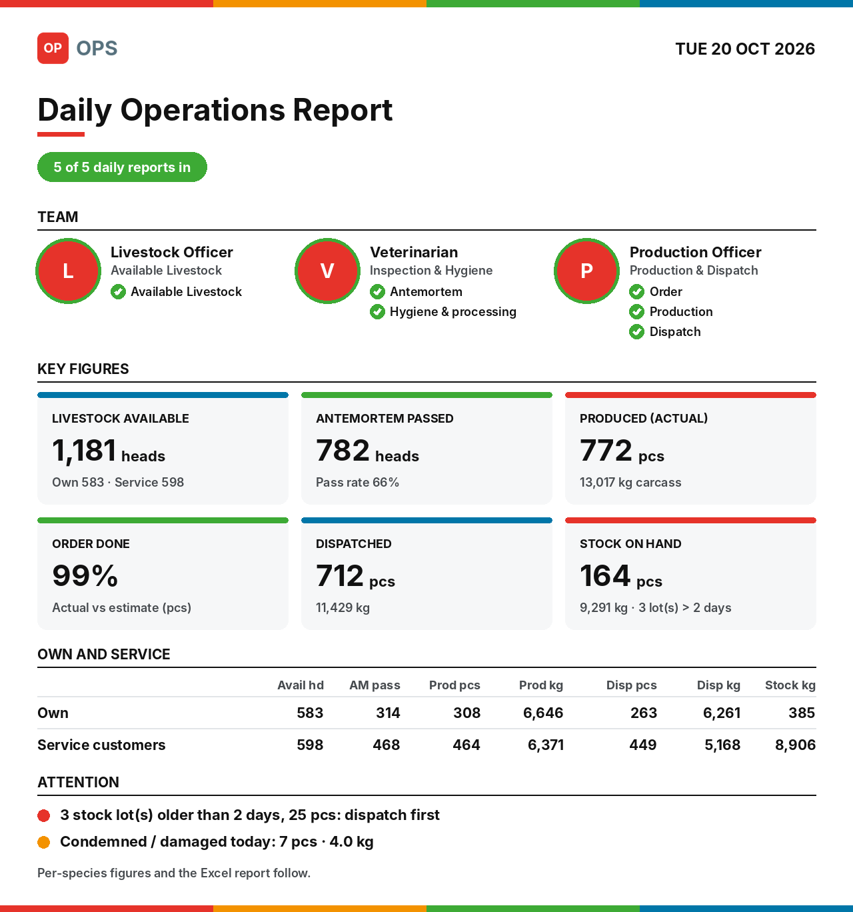
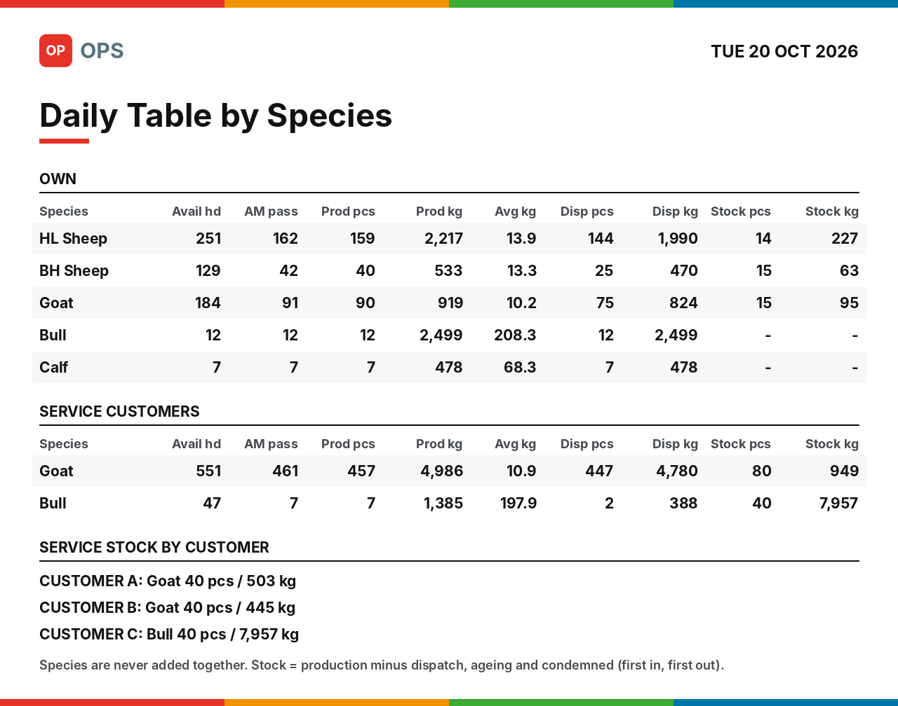
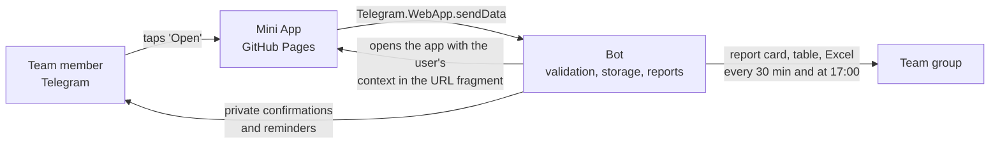

# Slaughterhouse Operations Mini App

A Telegram Mini App for the daily operations of a meat processing plant. It covers livestock intake, ante-mortem
inspection, hygiene, production planning, production, dispatch, condemnation and stock, with full batch
traceability. Each team member records only their own data from their phone. The plant receives a clear,
consistent report several times a day.

This repository holds the **front end**: a single, self-contained web page served through GitHub Pages and opened
inside Telegram. A companion Telegram bot (kept privately) validates the entries, stores them and produces the
reports.

---

## Screenshots

**The app: Operations, Report, Stock and Team tabs**

**Data entry: available livestock, correcting a saved line, inspection & hygiene by production date, stock**

**Report card and table by species, posted to the team group**

  
  

Screenshots use sample data. Names, customers and suppliers are placeholders.

---

## Why it exists

Daily figures in a slaughterhouse are usually typed as free text into chat groups, by several people, in
different formats. Totals are hard to check, stock is estimated rather than calculated, and tracing a carcass back
to its supplier takes hours.

This app replaces that with:

- **Locked, role-based forms.** Each person sees only the entries they are responsible for.
- **Validation at the source.** Numbers are checked before they are saved, for example carcass weight per head,
  stock available for dispatch, or a physical count against the book.
- **Calculated stock.** Stock is calculated, not typed: production minus dispatch, condemnation and weight loss,
  first in, first out.
- **Automatic batch numbers.** Every carcass batch links back to the livestock it came from and forward to where
  it went.
- **One report.** The same figures appear in the app, in the group and in Excel.

---

## Features

| Area | What it does |
|---|---|
| **Available livestock** | One line per truck or supplier: owner, species, heads, supplier, plate number and origin. The day's totals are built from these lines. |
| **Ante-mortem** | Heads that passed inspection, own and per service customer. |
| **Inspection & hygiene** | Recorded per **production date**: ante-mortem and post-mortem results, staff, slaughter hall, lairage and delivery truck. Includes processing, chilling, cold rooms and machinery. Linked automatically to that day's batches. |
| **Production order (plan)** | Estimated pieces and kg per channel and customer. Kg is estimated from the recent average carcass weight. |
| **Production (actual)** | Actual pieces and hot carcass weight, compared live with the plan. |
| **Dispatch** | Pieces and kg per channel and customer, with packing, delivery, truck and temperature details. |
| **Condemnation & damage** | Stage, product from the approved item list, species, quantity and reason. |
| **Stock** | Pick an approved item, record a physical count or a movement, in the item's unit (pcs, kg or both). A count that differs from the book needs an explanation. |
| **Report tab** | Today's status, key figures, a table by species (own and service apart) and alerts. |
| **Stock tab** | Carcass stock by owner and species with age flags, and item stock. |
| **Team tab** | Every team member with photo, role and today's status. |
| **Edit anywhere** | Every entry can be corrected while it is being entered and after it is saved. Each change is logged. |

### Reporting

- **In the group, every 30 minutes** during working hours: a report card, a table by species and the Excel report.
  An update is posted only when a figure changed, and it replaces the previous one. The final report goes out at
  17:00.
- **Privately, on request:** the report card, the Excel report, or both.
- **Reminders by private message:** in the morning, late morning and before the final report, listing only what
  is still missing for each person.

### Excel report (four sheets)

1. **Operations:** livestock, ante-mortem, plan vs actual, dispatch and the daily entry status.
2. **Traceability:** one row per batch, from the livestock lines through hygiene, production and condemnation to
   dispatch and expiry.
3. **Shelf Life:** carcass in stock with age, expiry date, days left and status.
4. **Stock Balance:** carcass by owner and species, and the approved items.

---

## How it works

1. The bot gives each user an **Open** button. The button address carries that user's context (role, allowed
   entries, today's saved figures) in the **URL fragment** (`#...`), compressed.
2. The page reads the fragment in the browser. **The fragment is never sent to the web host**, so GitHub Pages
   only serves the static page and never sees any operational data.
3. When the user saves, the app sends the entry back through Telegram (`sendData`). The bot checks who sent it,
   validates every field and stores it.
4. The bot answers privately and builds the reports.

There is no server for the app, no database on the web host and no build step.

---

## Roles

| Role | Entries |
|---|---|
| Livestock officer | Available livestock |
| Veterinarian | Ante-mortem, inspection & hygiene (with processing & chilling), condemnation & damage |
| Production & stock officer | Production order, production, dispatch, stock |
| Managers and viewers | Report, stock and team tabs, Excel, traceability |
| Administrator | Everything |

Each Telegram username is locked to its account on first use, so a changed or reused username cannot post on
someone else's behalf.

---

## Traceability model

| Identifier | Format | Example |
|---|---|---|
| Livestock lot (one line / truck) | `LV-yymmdd-NN` | `LV-261021-03` |
| Carcass batch | `yymmdd-OWNER-SPECIES` | `261021-OWN-GOT` |

- Livestock lots are linked to batches **first in, first out** by heads, per owner and species.
- Hygiene and processing are recorded **per production date**, so every batch of that date carries them.
- Expiry = production date + chilled shelf life (configurable).
- Lot numbers are never reused, including after a correction or removal.

---

## Repository contents

| File | Purpose |
|---|---|
| `index.html` | The complete Mini App: markup, styles, scripts and embedded images in one file. |
| `README.md` | This document. |
| `` | Images used in this document. |

---

## Deployment

1. **Publish the page:** in this repository open **Settings → Pages**, choose **Deploy from a branch**, branch
   `main`, folder `/ (root)`, and save. The app is then served at
   `https://<user>.github.io/<repository>/`.
2. **Connect the bot:** set that address as the Mini App URL in the bot's configuration (`MINIAPP_URL`) and
   restart the bot.
3. **Update the app:** upload a new `index.html` and commit. The bot adds a version number to the address, so
   Telegram loads the new page instead of a cached copy.

### Compatibility

The page is written for old and new web engines alike: no external frameworks and no modern-only CSS or
JavaScript features, plus a built-in decompressor for clients without `DecompressionStream`. It runs in Telegram
on iOS, Android, Windows and macOS, including older macOS versions.

---

## Privacy and security

- No operational data is stored on, or sent to, the web host.
- All entries are validated again by the bot. The page is a form, not the authority.
- Permissions are enforced by the bot per Telegram account, not by the page.
- The Excel reports are protected against editing.

---

## Status

In daily use. Planned next steps are cloud hosting for the bot, so it no longer depends on one computer, and
multi-language labels.

---

**Developed by Tadele B.** · For support, inquiries or further information: tadelebek@gmail.com
